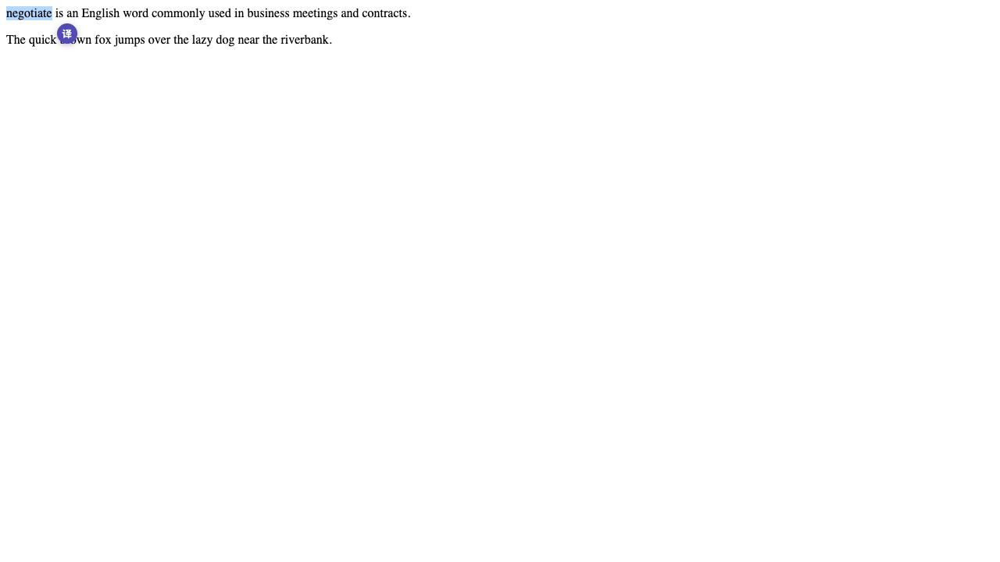
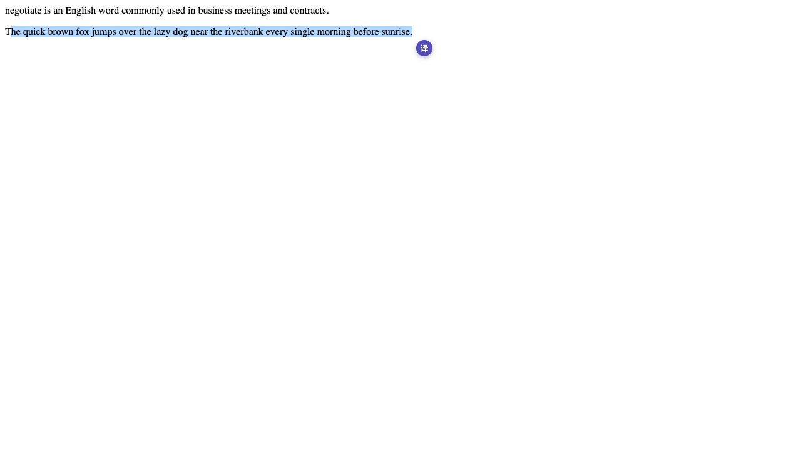
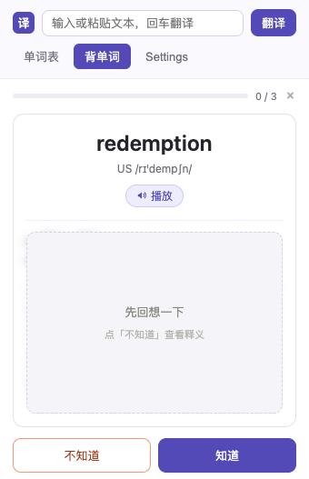
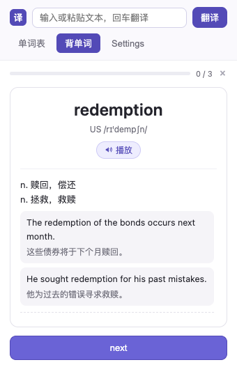
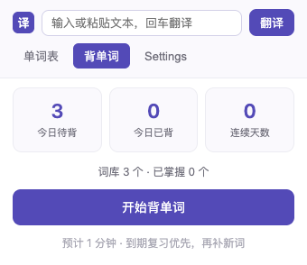
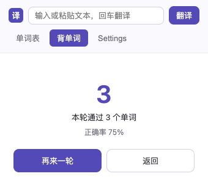

# WordCard 画词翻译

> A Chrome extension for select-to-translate, powered by LLM (DeepSeek).
> 划词翻译 Chrome 插件 —— 选中文字，点一下，单词卡 / 整句翻译立刻弹出。

[](https://developer.chrome.com/docs/extensions/develop/migrate) []() [](LICENSE)

选中网页上的任何内容，旁边会浮出一个小图标，点击即可查看：

- **单词卡**（≤ 30 字符）：单词、美/英音标、🔊 发音、中文释义、双语例句，⭐ 一键收藏
- **翻译卡**（> 30 字符）：上方原文、下方译文，长内容自动滚动

翻译由大模型驱动，默认适配 **DeepSeek API**（OpenAI 兼容格式），自带配置页，填入自己的 Key 即可用。

收藏的单词会自动进入**背单词**词库，按艾宾浩斯遗忘曲线每天安排复习，两段式卡片先回想、再对答案。





## ✨ 功能特性

- 🖱 **划词即译**：鼠标选中文字 → 浮出小图标 → 点击弹出卡片，Esc 或点空白关闭
- 📇 **智能双模式**：短内容走词典模式（音标/释义/例句），长内容自动切换整句翻译模式
- 🔗 **词形扩展**：单词卡展示名词/动词/形容词/副词等派生词形（如 redemption → redeem / redemptive），划词卡片与 popup 中点击词形均可直接连查，支持逐级返回，学一个词串一串
- ⭐ **本地收藏**：单词卡一键收藏/取消，点击插件图标查看单词表（按收藏时间倒序，可点开重看卡片）
- ⌨️ **输入翻译**：popup 顶部输入框直接输入/粘贴文本翻译，回车或点击「翻译」即可，长文本自动进入段落翻译模式
- 📚 **背单词**：收藏的单词自动成为词库，按艾宾浩斯遗忘曲线每天生成复习队列，两段式卡片（词面 / 遮罩释义）做主动回忆，知道 / 不知道两键反馈，记录连续打卡与正确率
- 🌐 **中英互译**：自动识别输入语言，英文 → 中文，中文 → 英文
- 🔊 **免费发音**：浏览器内置 TTS，无需第三方服务
- ⚡ **24 小时缓存**：同一内容不重复请求，省 token
- 🔧 **多模型可扩展**：Provider 抽象层设计，适配新的 LLM 只需新增一个文件
- 🧾 **调试日志**：content script 与 background 全链路打印划词内容与 LLM 请求/响应

## 📦 安装（开发者模式加载）

1. 下载或克隆本项目：
   ```bash
   git clone <repo-url>
   ```
2. 打开 Chrome，进入 `chrome://extensions`
3. 右上角开启 **Developer mode**
4. 点击 **Load unpacked**，选择项目根目录（包含 `manifest.json` 的文件夹）

> 修改代码后生效：`chrome://extensions` 中点扩展卡片上的 **↻** 重新加载，再刷新网页。

## 🔑 配置 DeepSeek API Key

1. 注册并登录 [DeepSeek Open Platform](https://platform.deepseek.com)，创建一个 API Key
2. 点击浏览器工具栏的 WordCard 图标 → **Settings**
3. 填写表单：

| 配置项 | 默认值 | 说明 |
|---|---|---|
| Base URL | `https://api.deepseek.com` | 无需修改 |
| Model | `deepseek-chat` | 也可填 `deepseek-reasoner` |
| API Key | — | 你的 `sk-...` 密钥 |

4. 点击 **保存**，再点 **测试连接** 验证（调用 `/models`，不消耗 token）

## 🖱 使用

| 操作 | 效果 |
|---|---|
| 选中文字（拖选 / 双击） | 旁边浮出紫色 "译" 图标 |
| 点击图标 | 弹出单词卡或翻译卡 |
| 点 🔊 | 播放发音（浏览器 TTS） |
| 点 ⭐ | 收藏 / 取消收藏 |
| 点击插件图标 | 单词表 / 背单词 / Settings 三入口 |
| Esc 或点空白处 | 关闭卡片 |

## 📚 背单词

收藏即入词库。点击插件图标 → **背单词** → `开始背单词`：

| 区域 | 内容 |
|---|---|
| 顶部 | 进度条 + `已通过 / 总数` + 退出（进度自动保存，重开可续） |
| 第一部分 | 单词、美式音标、🔊 发音（进入自动播一次） |
| 第二部分 | 默认被遮罩盖住 → 点「不知道」后展开释义、例句、词形变化 |
| 底部 | `知道` / `不知道`；点「不知道」后变成 `next` |

快捷键：`1` 知道 · `2` 不知道 · `空格` 展开 / 下一词 · `Esc` 退出。

 

### 复习间隔（艾宾浩斯固定间隔）

| 已通过次数 | 1 | 2 | 3 | 4 | 5 | 6 | 7 |
|---|---|---|---|---|---|---|---|
| 下次复习 | 1 天 | 2 天 | 4 天 | 7 天 | 15 天 | 30 天 | 60 天后毕业 |

- **知道** → 通过次数 +1，间隔翻到下一档
- **不知道** → 回退两级，当天插回队尾再测一次（队列只剩一个词时不再插回，避免死循环）
- 通过 7 次（累计约 4 个月）标记为**已掌握**，不再进队列

### 每日队列

每天首次打开时生成**当日快照**并保存，当天不再变化：

```
队列 = 到期复习词（按到期时间升序） + 新词（未学过，按收藏时间正序，每日上限 10 个）
```

- 断点续背：关掉弹窗、重启浏览器，回来还是同一队、同一进度
- 没背完的词不会丢：到期时间已过，第二天自动重新进队
- 背单词过程 **不调用大模型**——释义、音标、例句在收藏时就已存好，离线也能背

### 记录

每日训练日志按天聚合，保留最近 90 天，用于计算连续打卡天数与正确率。

 

## 🔒 隐私说明

- **API Key、收藏的单词、背单词进度只存在你自己的浏览器里**（`chrome.storage.local`），不上传到任何服务器，也不会进入代码仓库
- 插件无埋点、不收集任何使用数据
- 翻译请求由你的浏览器直连你所配置的 DeepSeek API，中间无第三方
- 代码完全开源，可自行审计

## 🧱 项目结构

```
selection-translate/
├── manifest.json            # MV3 清单
├── background/
│   └── service-worker.js    # 消息路由 + LLM 调用 + 缓存
├── content/
│   └── content-script.js    # 划词检测、图标、Shadow DOM 卡片
├── providers/
│   └── deepseek.js          # DeepSeek 适配器（JSON mode 结构化输出）
├── storage/
│   ├── store.js             # 设置 / 收藏 / 缓存 / 复习进度读写
│   └── srs.js               # 背单词调度核心（纯函数，无 chrome API）
├── review/
│   ├── review-view.js       # 复习卡视图模块
│   └── review.css
├── popup/
│   ├── popup.html/.js/.css  # 单词表 + 单词卡详情 + 背单词 + Settings
├── tests/
│   └── srs.test.mjs         # 调度核心单元测试（26 项断言）
└── icons/                   # 插件图标
```

**设计要点**：

- Manifest V3 + 原生 JS，零构建零依赖，clone 即用
- 卡片 UI 用 Shadow DOM 隔离，不污染宿主页面样式，也不被宿主页覆盖
- 跨域请求统一走 background Service Worker（MV3 下 content script 受 CORS 限制）
- LLM 调用抽象为 Provider 接口（`translate(text, settings)`），适配其他模型只需在 `providers/` 新增文件
- 背单词的调度算法抽成纯函数（`storage/srs.js`），只有 `store.js` 接触 `chrome.storage`，算法层可脱离浏览器单测

## 🛠 调试

| 日志 | 位置 |
|---|---|
| `[WordCard] 鼠标划中的内容` / `icon shown` | 网页 DevTools Console（F12） |
| `[WordCard][bg] 收到消息 / 查询内容 / 缓存命中` | `chrome://extensions` → WordCard → 点击 **service worker** 打开的 Console |
| `[WordCard][LLM] >>> 请求体 / <<< 模型输出 / token 用量` | 同上 |

API Key 在日志中仅显示前 6 位，不会泄露。

## 🧪 开发与测试

```bash
# 背单词调度核心的单元测试（26 项断言，无需浏览器）
npm test        # 等价于 node tests/srs.test.mjs
```

插件本身无需构建，改完代码在 `chrome://extensions` 点 **↻** 重新加载即可。

## 🗺 Roadmap

- [x] 艾宾浩斯背单词 / 复习模式
- [ ] 更多 LLM Provider（OpenAI / Gemini / Claude / Ollama 本地模型）
- [ ] 收藏列表与背单词词库导出 CSV
- [ ] 背单词设置项：每日新词数、自动发音、暂停新词
- [ ] 单词级重置复习进度
- [ ] 输入框内划词支持
- [ ] 卡片内"重新翻译"按钮
- [ ] 上架 Chrome Web Store

## 📄 License

[MIT](LICENSE)
